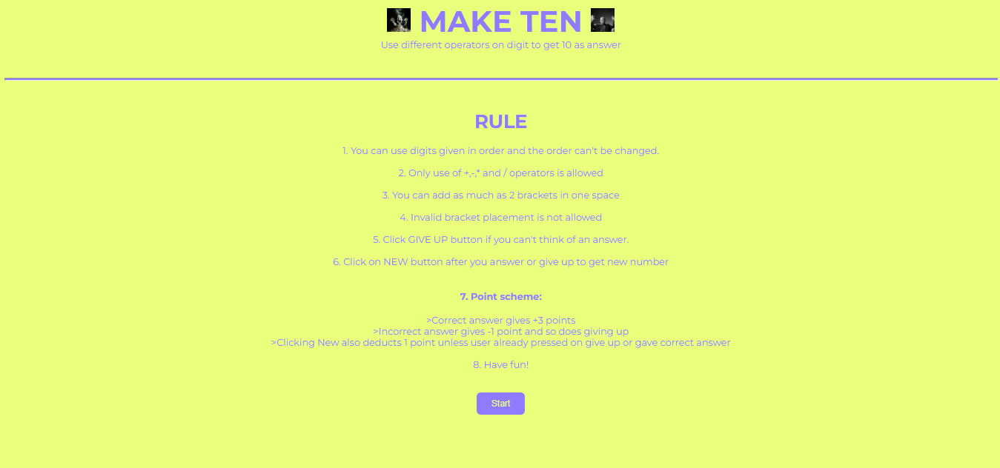
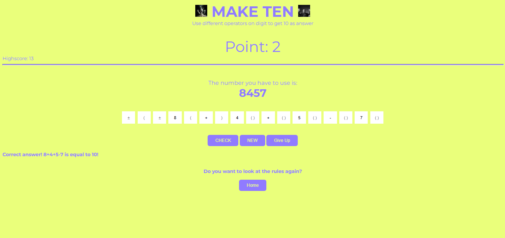

# make-ten
A web based mini-game about making ten from given 4 random numbers

**THE START BUTTON IS A BIT BELOW RULES TAB , SCROLL AND CLICK ON THE START BUTTON TO PLAY**

Why I built it
>I saw someone on tiktok do this and decided it would be a fun idea for a website as a beginner in javascript

Languages used
>HTML
>CSS
>JavaScript

Use case:
>Just a fun game I made to play at school

How to access:
> Go to https://shimes18.github.io/make-ten/

AI usage:
> used ai to debug 3-4 times (only used it find bug and did mosst of the debugging )
> used google overview when looking for syntax (Only few times, mostly I used w3school or geek4geek)
>Used to learn concepts while adding checkmakesten function

Preview:
> Right after you visit the website , youre greeted with this 

>After clicking start you see something like this:

